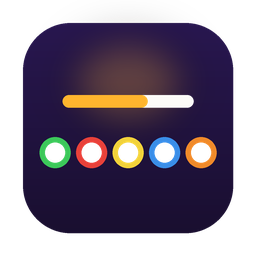
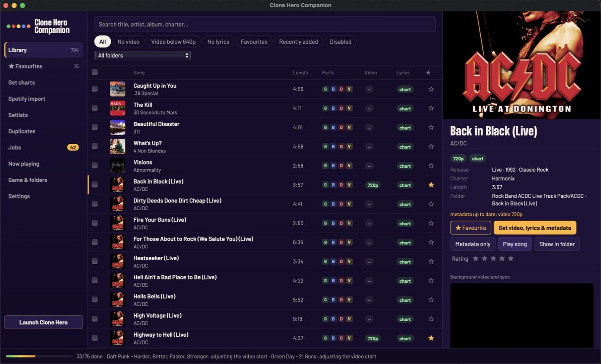
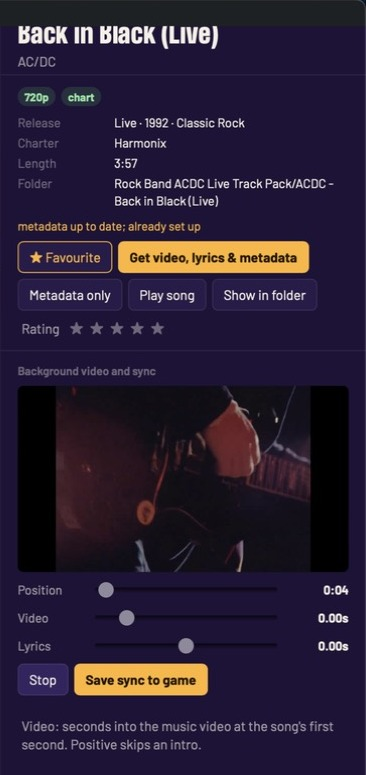
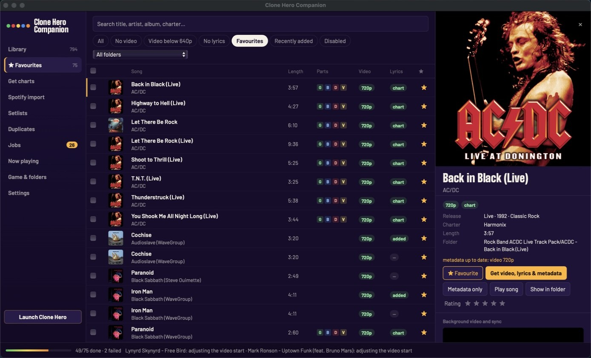
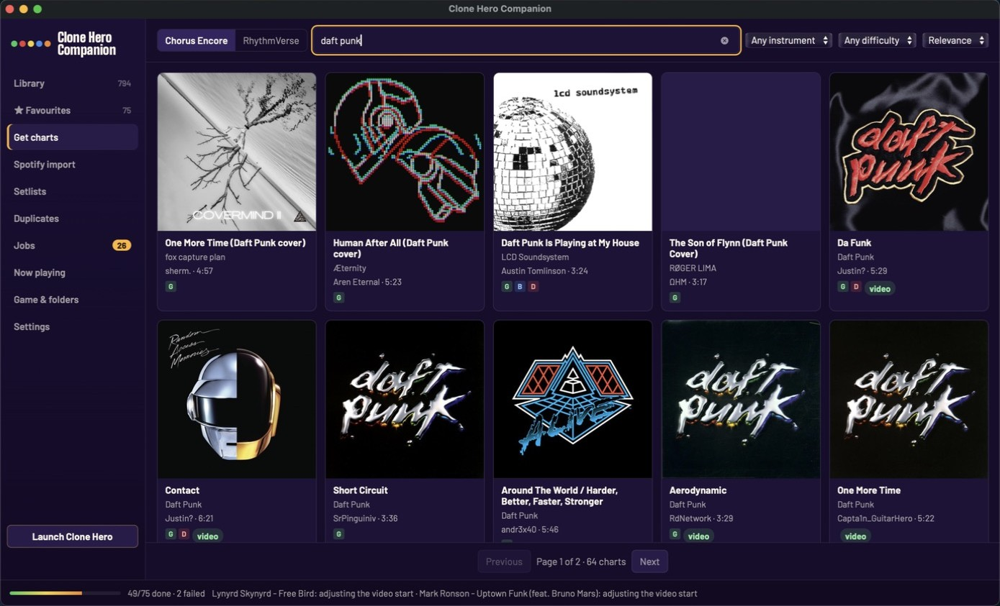
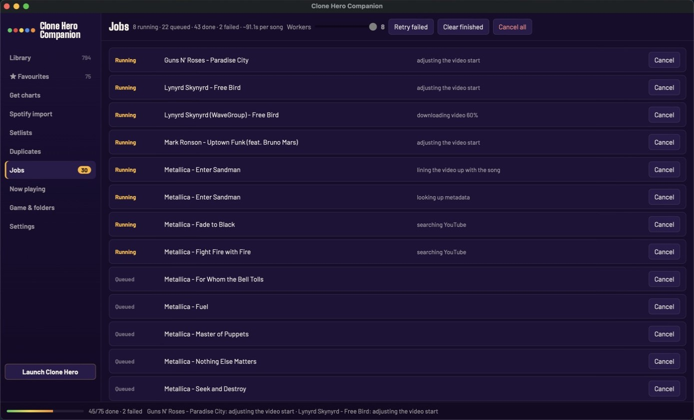
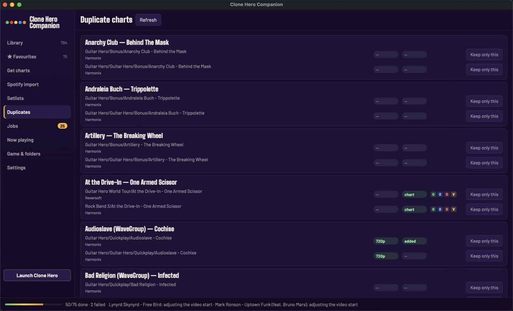
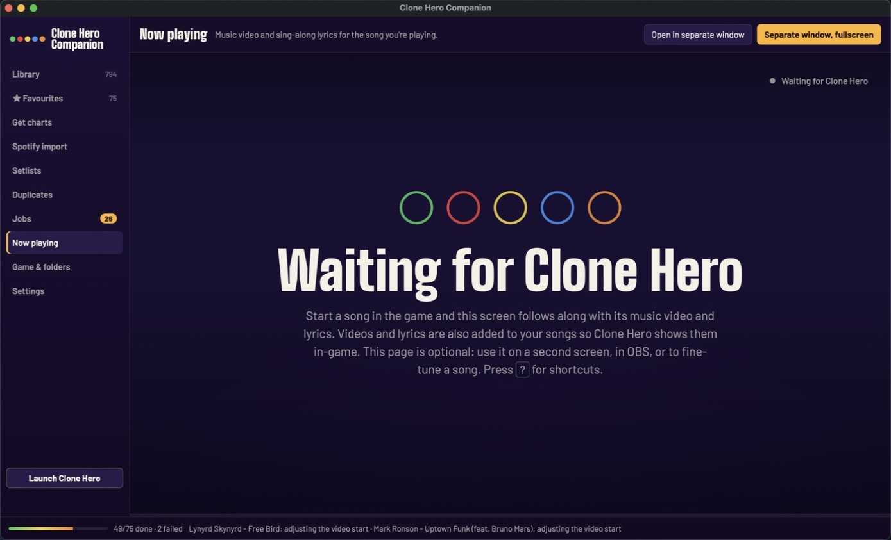

<div align="center">



# Clone Hero Companion

**Website & downloads: [cloneherocompanion.com](https://cloneherocompanion.com)**

**Clone Hero Companion adds HD music videos and sing-along lyrics to every song in [Clone Hero](https://clonehero.net),<br>plus the library manager and chart downloader you always wanted, in one app.**

[](https://github.com/Cr4zySh4rk/clone-hero-companion/releases/latest)
[](https://github.com/Cr4zySh4rk/clone-hero-companion/releases)

[](LICENSE)

[**Download**](#download) · [Features](#features) · [Quick start](#quick-start) · [FAQ](#faq) · [Report a bug](https://github.com/Cr4zySh4rk/clone-hero-companion/issues/new/choose)


</div>

## Why

Clone Hero can play a background video behind the highway and show lyrics, but most charts ship with neither. Finding the right music video, getting it in decent quality, lining it up with the chart's audio and adding lyrics is a lot of manual work per song. Clone Hero Companion does it for your whole library in one go, and keeps doing it for every new song while you play.

## Features

### 🎬 HD music videos behind the highway
Select any number of songs and press **Run**. For each song the app finds the official music video on YouTube, downloads it and **lines it up with the chart by matching the video's soundtrack against the chart audio**. Only **640p or better** is ever accepted (720p preferred, 1080p optional): no blurry 360p uploads and no static "album art" videos.

### 🎤 Lyrics in the game
Charts with a vocals part already show lyrics. For the rest, time-synced lyrics from [LRCLIB](https://lrclib.net) are written into the chart and aligned to the chart's own audio, so Clone Hero shows them in-game.

### 🗂️ A real library manager



- Fast virtualized list for thousands of songs: album art, instruments, video quality, lyrics status
- Search, filters (*No video*, *Video below 640p*, *No lyrics*, *Favourites*, *Recently added*, *Disabled*) and sorting on every column
- Multi-select with click, ⌘/Ctrl-click, Shift-click and ⌘/Ctrl-A
- **One-click metadata:** album, year, genre, length and high-resolution album art from Chorus Encore and iTunes
- Disable songs (moved out of the game's way), Move to Trash, rename folders by template, export chart packs (.zip)
- **Per-song sync editor** with live video and audio preview, plus a video picker that only offers HD candidates
- Built-in player to listen to any chart's audio

<p align="center"><br>
<sub>The sync editor: preview the music video against the song and nudge the video or lyrics until they line up, then save it to the game.</sub></p>

### ⭐ Favourites, also in the game



Star songs with one click (or press **F**). The app keeps a **Favourites setlist** in sync, so the same list is one click away inside Clone Hero.

### 📥 Get charts



- Search **Chorus Encore** and **RhythmVerse** with instrument, difficulty and sort filters, and ▶ preview a chart's audio before downloading
- One-click download and install of .sng, .zip and .7z (and .rar when an unrar tool or 7-Zip is installed), including Google Drive, Mediafire and Dropbox links
- New charts can get their video, lyrics and metadata right after downloading
- **Spotify import:** paste a public playlist link and the app finds a chart for every song and marks the ones you already have

### ☁️ Profile, cloud sync and CH Leaderboards (v2.1)

- **Optional account.** Sign in from the **Profile** page with Google, or with a 6-digit code sent to your email. Everything keeps working signed out and offline; cloud failures are retried quietly in the background. The session is stored only in your app config folder (`cloud_session.json`).
- **Favourites follow you.** Favourites sync both ways (a few seconds after each change, at start-up and on sign-in). The Favourites view lists "In your cloud, not on this machine" with **Install all**, which finds each chart on Chorus Encore and downloads it (optionally adding video, lyrics and metadata).
- **v2.1.1:** favourites are now per chart (a Harmonix and a Neversoft chart of one song star independently), unstarring sticks, and removals sync both ways.
- **Play stats.** After every song Clone Hero writes `scorestats.json`; the app records each play on your computer (`plays.jsonl`) and, when signed in, merges plays from all your machines. Profile shows plays, hours, accuracy, full combos, streaks, a 26-week activity map, most played / best / needs practice lists, recent plays and personal bests, filterable by instrument and difficulty. Importing older history from `scoredata.bin` is not supported.
- **CH Leaderboards (read-only).** Song panels and the Now playing screen show the global top scores, plus your rank once you link your CH Leaderboards username in Profile. The **Leaderboards** page shows site totals, top players, trending songs and the latest scores. Scores cannot be submitted from this app: the game submits replays itself in leaderboards mode.

### ⚡ Fast, parallel batch processing



A pool of worker threads processes songs in parallel; you choose how many. YouTube requests are paced across all workers, and the app backs off and retries on its own when YouTube pushes back.

### 🧹 Duplicates and setlists



Find the same song charted more than once and keep the one you want. Create and edit Clone Hero **setlists** straight from your library.

### 🖥️ Works while you play
The app follows the game through its log file. It starts preparing a song **as soon as you highlight it in Clone Hero's song list**, and every song you play is ready next time. For a second monitor, a TV or a stream, the karaoke-style **Now Playing** screen shows the video and lyrics in sync with the game, in its own window or fullscreen.



## Download

Grab the file for your system from the **[latest release](https://github.com/Cr4zySh4rk/clone-hero-companion/releases/latest)**:

| System | File |
| --- | --- |
| **macOS** 11 or newer, Apple Silicon and Intel | `CloneHeroCompanion-macOS-universal.dmg` |
| **Windows** 10 / 11 | `CloneHeroCompanion-windows-x64.exe` |
| **Linux** x64 | `CloneHeroCompanion-linux-x64.tar.gz` |

Everything is included (ffmpeg and yt-dlp, which keeps itself up to date). Nothing else to install.

<details>
<summary><b>macOS:</b> first launch</summary>

Open the .dmg and drag **Clone Hero Companion** to Applications. The app isn't notarized by Apple, so the first time, right-click it and choose **Open**, then **Open** again. If macOS says the app "is damaged", run this once in Terminal:

```
xattr -cr "/Applications/Clone Hero Companion.app"
```

Recommended: *Game & folders → Grant Full Disk Access…* opens the right page of System Settings. Switch **Clone Hero Companion** on so macOS doesn't ask about every protected folder (Documents, Desktop, external drives) separately.
</details>

<details>
<summary><b>Windows:</b> SmartScreen</summary>

Run the .exe. SmartScreen may warn because the app isn't code-signed: click **More info → Run anyway**. The window uses Microsoft Edge WebView2, which comes with Windows 10/11.
</details>

<details>
<summary><b>Linux</b></summary>

```
tar xzf CloneHeroCompanion-linux-x64.tar.gz
./CloneHeroCompanion
```

The window opens in Chrome/Chromium/Edge app mode if one is installed, otherwise in your browser. Videos are saved as VP8 `.webm`, the format Clone Hero plays on Linux.
</details>

## Quick start

1. In Clone Hero, turn on **Settings → Custom Content → Song Videos** (and keep **Lyrics** on).
2. Open Clone Hero Companion. The **Game & folders** screen shows what it found: the game, its data folder (the one with `settings.ini` and `Logs`) and your song folders. Confirm them, or **Browse…** to any other location or drive.
3. Select songs (or ⌘/Ctrl-A for everything shown), press **Run**, choose what to get (video, lyrics, metadata) and **Start**.
4. Keep the app open while you play: new songs get prepared as you browse.

After downloading new charts, run **Settings → Scan Songs** in Clone Hero so the game sees them. Setlist changes show after restarting the game.

## FAQ

<details>
<summary><b>Will it mess up my songs or my scores?</b></summary>

Every file the app changes is backed up first (`*.chc-backup` next to it), and **Undo changes** puts the originals back. Videos, video alignment and metadata don't affect scores. Adding lyrics changes the chart file, so Clone Hero starts a fresh high-score list for that chart (your old scores come back if you undo). To leave charts untouched, turn off *Settings → In the game → Lyrics*.

| | Song folder | `.sng` package |
| --- | --- | --- |
| Video | `video.mp4` (H.264), `video.webm` (VP8) on Linux | added inside the package |
| Video alignment | `video_start_time` in `song.ini` | package metadata |
| Lyrics (charts without them) | vocals track in `notes.mid` / events in `notes.chart` | same, inside the package |
| Metadata | `album`, `year`, `genre`, `song_length`, `album.jpg` | package metadata, `album.jpg` |
</details>

<details>
<summary><b>Why does it skip some videos?</b></summary>

Quality is measured the way YouTube labels it, `max(height, width × 9/16)`, so a widescreen 1280×526 video counts as 720p, while 854×480, 640×480 and smaller are rejected. Still-image uploads (album-art "videos") are skipped too. When no candidate is 640p or better, the song is marked *none found* instead of getting a bad video. You can always paste a YouTube link of your own in the song panel.
</details>

<details>
<summary><b>The video or lyrics are a bit early or late.</b></summary>

Videos are lined up by comparing the video's soundtrack with the chart's audio stems in three windows of the song, and an offset is only used when they agree. Some live or extended versions can't be matched. Select the song, press **Preview**, drag the *Video* or *Lyrics* slider until it lines up and press **Save sync to game**.
</details>

<details>
<summary><b>Where is my Clone Hero folder?</b></summary>

The app finds it automatically in most cases. Usually it's `~/Clone Hero` on macOS, `Documents\Clone Hero` on Windows (possibly inside OneDrive), and `~/.clonehero` on Linux. Portable installs keep it next to the game. You can point the app anywhere on the **Game & folders** screen.
</details>

<details>
<summary><b>Does it send my data anywhere?</b></summary>

No accounts and no telemetry. The app only talks to the services it gets content from: YouTube (videos), LRCLIB (lyrics), Chorus Encore, RhythmVerse and iTunes (charts and metadata), and Spotify for playlists you paste. Everything runs on your computer.
</details>

<details>
<summary><b>Windows downloads fail with WinError 2 / cannot write to folder</b></summary>

If the app can read your library but cannot install charts or create the Favourites setlist,
check **Windows Security → Virus & threat protection → Protection history**. Controlled folder
access can block writes to Documents and report “The system cannot find the file specified”.

If Companion is listed as blocked, open **Manage ransomware protection → Allow an app through
Controlled folder access → Add an allowed app**, then select the Companion executable you run.
Restart Companion and retry the failed jobs. The allowance applies to that executable's location;
if you move or rename it, update the allowance. Keep Controlled folder access enabled.
See [Microsoft's instructions](https://support.microsoft.com/en-us/windows/security/threat-malware-protection/virus-and-threat-protection-in-the-windows-security-app).

The app checks that the Songs folder is writable before downloading. For other failures, the Jobs
tab includes the failed step, and `%APPDATA%\CloneHeroCompanion\companion.log` contains the traceback.
Copy the log before restarting the app, which replaces it.
</details>

<details>
<summary><b>Command line</b></summary>

The same program has a command line (the app window opens when it's started without arguments):

```
CloneHeroCompanion prepare [FILTER...] [--no-video] [--no-lyrics] [--force] [--dry-run]
CloneHeroCompanion restore [FILTER...]
CloneHeroCompanion doctor [--report FILE]
CloneHeroCompanion run [--no-browser] [--host 0.0.0.0] [--port 47823]   # background service only
```

On macOS the binary is `"/Applications/Clone Hero Companion.app/Contents/MacOS/Clone Hero Companion"`. With `--host 0.0.0.0`, the Now Playing screen can be opened from a TV, phone or OBS at `http://<your-computer>:47823/now`.
</details>

<details>
<summary><b>How does it know what I'm playing?</b></summary>

Clone Hero writes `<data folder>/Logs/Session-*.log`. *Loading Song: Artist - Name* marks a song start, seeks while playing are pauses (with the exact song time), and seeks in the menus match a song's `preview_start_time`, which is how the app knows what's highlighted in the song list.
</details>

## Building from source

```
python -m pip install -r requirements.txt pywebview send2trash py7zr pillow
python -m chcompanion                    # app window
python -m unittest discover -s tests     # tests
```

Releases are built by GitHub Actions on macOS (universal2), Windows and Linux; pushing a tag like `v2.1.0` publishes one. Issues and pull requests are welcome, see [CONTRIBUTING.md](CONTRIBUTING.md).

## Credits

Clone Hero Companion brings together ideas and features from three great community projects, in one standalone app:

- [**Bridge**](https://github.com/christopherwk210/bridge) by christopherwk210: library management and Chorus browsing
- [**Clone Hero Chart Manager**](https://github.com/xlzipx/clone-hero-chart-manager) by xlzipx: Encore and RhythmVerse search and download, Spotify import, setlists, duplicates
- [**BackstageHero**](https://github.com/jmb988/BackstageHero) by jmb988: background videos lined up by audio, self-updating yt-dlp, rate-limit handling

Built on [yt-dlp](https://github.com/yt-dlp/yt-dlp), [FFmpeg](https://ffmpeg.org), [LRCLIB](https://lrclib.net), [Chorus Encore](https://www.enchor.us), [RhythmVerse](https://rhythmverse.co) and [pywebview](https://pywebview.flowrl.com).

Clone Hero Companion is a fan-made tool and isn't affiliated with Clone Hero or its developers. Videos and lyrics are downloaded for your personal use; please respect the rights of the artists.

## License

[GPL-3.0](LICENSE)
